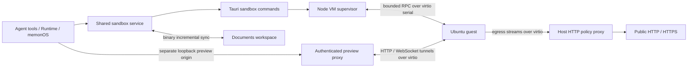

# Desktop Linux sandbox

The desktop app runs sandbox code in one persistent QEMU virtual machine using
the official Ubuntu 24.04 Minimal Cloud image. The same service supports agent
tools, the Runtime panel, and memonOS Terminal and embedded browser. Opening
memonOS is optional. Extension and web builds retain their browser sandbox.

The agent feature is named **Sandbox**. Enabling it starts the desktop VM
immediately. Selecting an enabled agent prewarms it, and beginning an enabled
agent run also starts it without needing a memonOS PC or a first tool call.
An explicit Stop suppresses passive prewarming until a Start, new run, feature
enable, or PC power-on requests it again. Desktop agent instructions describe
Ubuntu and native Python; execution and preview tools remain available without
requiring optional REPL or DOM render capabilities.

## Run and inspect

```sh
yarn dev:desktop
```

Open **Runtime → Desktop Sandbox → Start**, run an agent sandbox command, or turn
on a memonOS PC. PC power-on starts the VM immediately in the background, alongside
preparing desktop files. The first Ubuntu boot can take a few minutes while cloud-init provisions
the guest; later starts skip the cloud image's unnecessary network-online wait.
The status card reports startup and virtualization failures. Stop saves pending
workspace changes and powers off the VM.

The PC has one taskbar: apps and a settings tray share the same row. The tray
shows **Sandbox: Stopped / Starting / Ready / Error**. Open **Settings** at the
bottom right for a Windows 11-style settings popover,
with Sandbox Start, Stop, details, and startup logs. Sandbox is not a desktop app.
The panel accepts additional configuration sections as settings grow.
Stop works during boot too. All views share one lifecycle;
switching views does not undo an explicit stop. Desktop files never wait for boot.
Terminal input, paste, completion and command approval stay disabled until the VM
and its saved workspace have finished preparing. Restoring existing projects is
part of startup, so the first and second commands do not inherit that work.
A stopped VM requires Start in Settings before memonOS commands can run;
background terminal output polling cannot restart it. Native IPC omits undefined options; the guest
also accepts a null environment map from older renderers during upgrades.
Slow file-sync polls and host-change notifications share one queued follow-up
each, so command completion cannot accumulate an unbounded backlog of background
synchronization work. A command is complete only after its PTY output has drained,
including when its shell exits before its output reader finishes.
Human terminal commands synchronize their working folder on a priority queue.
Background uploads yield after a committed batch and resume afterward, while
terminal output does not wait for unrelated workspace transfers. Agent commands
retain their normal file-flush guarantee. Native sync uses 1 MiB / 64-operation
batches (a single file may exceed that byte target, up to the existing file limit).
Local memonOS requests wait for the job processor to subscribe before being
sent, preventing startup requests from being silently dropped.

Use memonOS Terminal or the agent's normal sandbox tools to try:

```sh
py --version
node --version
npm --version
git --version
printf 'hello from Linux\n' | tee hello.txt
py -m http.server 8000 --bind 127.0.0.1
```

`py` and `python3` use the image's system Python. Invoking `python` or `pip`
creates a persistent virtual environment. Node/npm/npx, Git, FFmpeg, ImageMagick,
and C build tools install inside Ubuntu on their first invocation. Installation
requires internet, reports progress in the command output, and persists across
app restarts. `magick` uses Ubuntu's ImageMagick `convert` compatibility command.

## Resources and host requirements

| Host | Acceleration | Requirement |
| --- | --- | --- |
| Windows x64 | WHPX | Enable CPU virtualization and Windows Hypervisor Platform; restart Windows after enabling it. |
| macOS Intel / Apple Silicon | HVF | Native matching architecture and a QEMU binary signed with the hypervisor entitlement. |
| Linux x64 / arm64 | KVM | Access to `/dev/kvm`; glibc 2.35 or newer for the pinned portable QEMU distribution. |

The supervisor requires hardware virtualization. It reports a failure instead of
falling back to software emulation or executing sandbox commands on the host.
Windows arm64 is currently unsupported by the pinned QEMU distribution.

The VM uses two virtual CPUs and up to 2 GiB of guest RAM while running. Its
20 GiB virtual disk grows as data is written; it does not allocate 20 GiB during
installation. These RAM and virtual disk limits are separate from app download
and installed sizes.

The staged Windows sandbox resources measure approximately **376 MiB**: around
248 MiB for the Ubuntu image plus QEMU, libraries, firmware, and the small guest
service. This is the sandbox portion of the app; the existing managed browser,
frontend, Node sidecar, and native shell add their own size. First use creates a
private copy of the base image plus a writable disk in app data. Downloaded
tools, package caches, and user projects grow that disk afterward. A strict
200 MB total sandbox bundle is not achieved by this configuration. The Windows
NSIS installer measures 620.2 MiB; installed app files total about 1.12 GiB
before VM data and downloaded tools. The portable output also contains a copy
of the installer under `bundle/`, which is excluded from that installed size.

Versions, download locations, and SHA-256 hashes are in
`apps/desktop/sandbox-runtime.lock.json`. Preparation downloads prebuilt images
and binaries; it does not build an Ubuntu image or preinstall developer tools.

```sh
yarn prepare:desktop:sidecar
yarn prepare:desktop:sandbox
```

Resources stage under `publish/.cache/tauri-resources/sandbox-runtime` and are
included in Tauri installers and portable desktop output. Portable QEMU assets
are pinned for Windows x64, macOS arm64, and Linux x64/arm64. Intel Mac builders
provide QEMU through Homebrew (`brew install qemu`) or `MEMORALL_QEMU_DIR`.
An explicit `MEMORALL_QEMU_DIR` overrides the prebuilt distribution on other
hosts too. macOS staging copies dependent dylibs and signs the bundle with
`com.apple.security.hypervisor`; `MEMORALL_QEMU_SIGN_IDENTITY` selects the signing
identity. Production signing and notarization still need the release identity.

QEMU notices and licenses accompany the runtime. The upstream
[portable build sources](https://github.com/jzombie/lab-qemu-portable/tree/qemu-v11.1.1-48)
record its Linux glibc baseline. The guest uses the
[official Ubuntu Minimal Cloud image](https://cloud-images.ubuntu.com/minimal/releases/noble/release-20261017/).

## Isolation and data flow



The VM has no network card, host disk mount, shared host directory, SSH server
exposure, Docker daemon, or host shell execution path. Guest commands run as the
unprivileged `memorall` user. Only fixed, validated tool-install operations use
guest root. Guest root is still untrusted by the host: the VM boundary and host
proxy policy remain the security boundary.

Outbound traffic is restricted to public web ports 80 and 443 through the
guest's configured HTTP/CONNECT proxy. The host resolves and pins checked
addresses, rejecting loopback, private networks, link-local/metadata addresses,
and reserved/transition address ranges. Clearing proxy variables does not open
a direct route. Tools that require raw outbound sockets, arbitrary ports, or
UDP need adaptation; guest-local servers and sockets work normally. Node's
native HTTP clients and `fetch` use its `--use-env-proxy` option by default;
`curl`, Python urllib, npm, Git HTTPS, and apt use the configured proxy too.

One installation shares one VM and one documents workspace across agents and
memonOS. Agent sessions are not separate VM security boundaries. Background
processes and tool installations remain guest-local. Normal app shutdown stops
the VM; the Windows native supervisor additionally puts its sidecar and child
processes in a kill-on-close job to handle force termination.

The bundled base image is checksum-verified before starting. A private base copy
and `base-image.json` stay next to the writable overlay so replacing the app's
bundled image cannot silently rebase an existing workspace onto different bytes.
Guest service updates use cloud-init with a fingerprint of both source and
bootstrap configuration. The service starts after cloud-final under
cloud-init.target, including subsequent boots. Do not remove
an existing VM's backing image or metadata while keeping its overlay.

Documents synchronize in binary batches with acknowledgements, including
background writes. The current transfer limit is 16 MiB per file. `node_modules`,
`.git`, `.venv`, `.next`, `.cache`, `__pycache__`, and `target` remain guest-local.
Persistent REPL, VM snapshots, and terminal resize are not advertised as
supported capabilities.

Each preview gets a separate random loopback port and an unguessable initial
URL. Requests require the capability or a same-origin browser request. The
supervisor strips its capability from upstream requests. Guest app cookies,
HTTP assets, and WebSockets are forwarded. A small injected bridge exposes only
the preview's DOM for memonOS outline, actions, history, and pictures; it has no
native app permissions. The parent checks message source, origin, and request
ID. Ordinary browser origin protections still apply to preview JavaScript.

## Verification

```sh
yarn typecheck
yarn typecheck:desktop:sidecar
yarn test:desktop:sidecar
yarn test:sandbox:unit
yarn test:desktop:sandbox
yarn test:desktop:sandbox --online --browser --restart
```

Prepare native runtimes first. The smoke test boots real accelerated QEMU in a
disposable app-data directory under `publish/.cache/sandbox-smoke-*`. It checks
binary file sync, PTY input/output, process stopping, preview authorization, and
traversal rejection. `--online` checks network denial and first-use tool
installation. `--browser` starts real Vite/React, loads it through a cross-origin
iframe with third-party-cookie phaseout enabled, exercises the DOM bridge and
capture, and changes source to verify WebSocket HMR. `--restart` verifies disk
and tool persistence. `MEMORALL_VM_SMOKE_DATA_DIR` reuses a disposable test VM.

Unit tests do not require hardware virtualization. Real VM, packaging, signing,
and native window acceptance must also run on each supported host architecture.

After building the Windows app, set `MEMORALL_SANDBOX_E2E=1` and run
`yarn test:e2e:desktop:built` to exercise the production memonOS client, initial
desktop files while the VM starts in parallel, Sandbox stop/restart, disabled
Terminal input before readiness, repeated Linux `ls` commands,
Python output, and a preview in the packaged WebView. The test also checks that
preview JavaScript cannot invoke native app commands. It uses a separate
WebView profile and VM under `publish/.cache/native-sandbox-smoke`; the CLI smoke
above also uses disposable data. `MEMORALL_VM_DATA_DIR` can select an existing
test VM for native acceptance without sharing the installed app's VM.

Windows x64 acceptance on 2026-10-18 passed first boot, lazy Node/npm/Git
installation, binary sync, PTY input, public HTTPS and blocked metadata access,
Vite/React in a cross-origin iframe, DOM actions and capture, WebSocket HMR,
and a subsequent boot preserving files and installed tools. Updating an existing
VM's bootstrap and restarting it also passed. Native WebView acceptance passed
Linux command output and denial of native commands from preview content.
Production memonOS acceptance checks eight consecutive `ls` commands, five during
a 21 MiB background transfer, and another after restarting the VM. Each must finish
within three seconds with complete output. Desktop files are included in the first
snapshot without waiting for VM boot. The native fixture uses its own folder grant
registry, VM, and WebView profile. Native UI acceptance also checks the taskbar settings
popover, cancellation during startup, and stopping a running
command without background polls restarting the VM. Screenshots are saved under
`publish/.cache/native-sandbox-smoke/` (`starting.png`, `terminal.png`, `stopped.png`).
The Windows 0.5.49 run displayed desktop files in 3.23 seconds while the VM was
starting. Its first `ls` took 2.53 seconds; the next seven took 36–231 ms, the five
during the background upload took 218–1399 ms, and the command after restart took
1.49 seconds. These are acceptance measurements on the test PC, not timing guarantees.
macOS and Linux native acceptance has not been run on those hosts.
