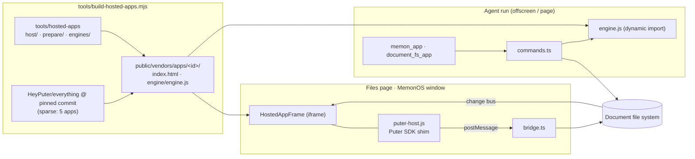

# Hosted apps: Spreadsheet, Documents, Presentation, Whiteboard, PDF

Memorall opens Office files in full editors on the Files page and in
MemonOS, and the agent edits the same files with each app's own document
code. The editors are five apps from
[HeyPuter/everything](https://github.com/HeyPuter/everything) (MIT,
Puter Technologies Inc.), built from a pinned commit and hosted as pages of
Memorall's own.

| App | Opens | Upstream engine | Agent commands |
|---|---|---|---|
| Spreadsheet | `.xlsx .xlsm .ods` | own Workbook + formula engine, patched SheetJS CE | the app assistant's 21 tools (`core/aitools.js`) |
| Documents | `.docx .dotx .docm` | own DOCX codec and canvas editor | 14 commands over `TextDocument` (written for Memorall) |
| Presentation | `.pptx` | OfficeKit pptx (MIT, TypeScript) | the app assistant's 22 tools (`assistant-tools.js`) |
| Whiteboard | `.whiteboard` (the app's board JSON) | own canvas board | 9 commands over the board JSON and `scene.js` |
| PDF | `.pdf` | pdf.js (view) + pdf-lib (write) | 18 commands over `core/*` and `PdfSession` |

## How it fits together

- **The file is the truth.** The app in the frame reads and autosaves the
  file through its Puter SDK; the agent opens the same file with the app's
  engine, runs commands, and writes it once. `HostedAppFrame` hashes the file:
  its own saves do nothing, anyone else's (the agent's, another window's)
  reopen the app on the new file.
- **One Puter-compatible host, not five integrations.** Each upstream app
  keeps every Puter call in one adapter and runs "inside the Puter desktop"
  when `puter.env === "app"`: it is launched with file items
  (`puter.ui.onLaunchedWithItems`), reads with `puter.fs.read`, saves with
  `puter.fs.write`. `tools/hosted-apps/host/puter-host.js` is that SDK,
  answered by Memorall over `postMessage`
  (`src/services/memon/apps/hosted/protocol.ts`). Collaboration, sharing,
  publishing and workers are left undefined, so the apps hide them;
  what they still draw for Puter's cloud (Sign in, Share, organizations) is
  hidden by per-app selectors (`hide` in `apps.mjs`), and the word the user
  reads for the host, "Puter", becomes "Memorall" ("Saved to Memorall").
- **"Open from Memorall…"** opens Memorall's own file picker
  (`HostedFilePicker`), from the open file's folder, filtered to what the app
  takes. "Save as" saves next to the open file.
- **Engines are the apps' own code.** `tools/hosted-apps/engines/<id>.js` is
  built from the same pinned source into `engine/engine.js`: open bytes,
  describe, run commands, save bytes (contract:
  `src/services/memon/apps/hosted/engine-types.ts`). Spreadsheet and
  Presentation reuse the tool layers of their in-app assistants; Documents,
  Whiteboard and PDF get command sets written over the apps' models. Every
  command is all-or-nothing.
- **AI is the user's chosen model.** The apps' own AI (Presentation's and
  Spreadsheet's assistants, Documents' rewrite, translate and Smart Lookup,
  Whiteboard's summaries and handwriting) calls `puter.ai.chat`; the shim
  sends it to the host, which asks the chat model chosen in Memorall
  (`ai.ts`, through the LLM service) and streams the answer back as Puter's
  parts (`text`, `tool_use`, `usage`). The model an app names is Puter's
  choice and is not used. Pictures (a URL, a file) go as image parts. Only
  chat is offered: an app shows its picture and speech features only where
  the SDK has them.
- **Memorall's assistant for an app without one.** PDF has no AI of its own:
  its rail gets an AI button (`prepare/pdf.js`) that opens
  `HostedAssistantPanel` beside the frame. The panel's model works on the
  open file with the app's engine commands as tools (`assistant.ts`), the
  same commands the agent runs; each round of calls is one write, so the
  app reopens on the result. Any app can ask for it with a `notify`
  `assistant`.
- **Where things live.** Shared logic in `src/services/memon/apps/hosted/`
  (catalog, protocol, bridge, command runner, engine loader, MemonOS app);
  the frame in `src/main/modules/files/components/HostedAppFrame.tsx`, used by
  `DocumentViewer` and MemonOS's `windows/HostedAppWindow.tsx`.

### Formats

What each app opens (all of them can also be uploaded):

| App | Edits in place | Opens, saves a copy in its own format beside it | Not supported |
|---|---|---|---|
| Spreadsheet | `.xlsx` | `.xlsm`, `.xls`, `.ods` | `.numbers` |
| Documents | `.docx` | `.dotx`, `.docm`; Hanword `.hwp`, `.hwpx` (converted) | `.doc` (Word 97–2003), `.odt`, `.rtf` |
| Presentation | `.pptx` | — | `.ppt`, `.odp`, `.key` |
| Whiteboard | `.whiteboard` (the board's JSON) | — | — |
| PDF | `.pdf` | — | — |

The agent's engines read every format listed and write back only what they
produce faithfully: Spreadsheet `.xlsx` and `.ods`, Documents `.docx`. The
rest open to read (writing them would drop macros or a template's type, or
cannot be done at all); the agent writes a new `.xlsx` or `.docx` instead.
CSV, TSV, Markdown and plain text stay in Memorall's own editors.

### Files page

`DocumentViewer` renders the app for any file a hosted app opens, when the
build has it (`public/vendors/apps/apps.json`); otherwise the built-in
viewers stay. "New file" offers the apps, and a new file's first bytes come
from the app's engine (an empty `.xlsx` does not open). Saves are quiet, as
the text editor's are: the library does not redraw under the editor. What an
app keeps on its own (Spreadsheet's version history, Documents' templates)
goes to one folder, `/.apps`, not beside every file opened.

### MemonOS

Each app is a window app (`MemonWindowApp`), in the dock when Files is on.
Opening an Office file routes to its app (`MemonMachine.openFile`). The
machine-side `MemonHostedApps` keeps each window's file and the engine's
description of it, which is what the agent's screen shows. A user's save in
the app is a `hosted.saved` operation: it takes the computer over if the
agent is mid-action and is logged as the user's change. Closing a window
first asks the app to save (`requestClose`).

### The agent

- MemonOS: `memon_app { path }` shows the file and lists the app's commands;
  `{ path, commands: [{ name, args }] }` runs them and saves once;
  `{ path, help }` gives one command's parameters.
- Without MemonOS, the document tools: `document_fs_app` (same shape, with
  `file_path`).
- A path that does not exist yet makes the file.

## Build and deployment

`node tools/build-hosted-apps.mjs` (also `yarn apps:hosted`):

1. **Source.** Sparse, shallow, blob-filtered fetch of the pinned commit
   (`tools/hosted-apps/apps.mjs`): only the five apps and `dev/`; the
   upstream repo also holds 46 other apps and ~550 MB of committed audit
   builds. Cached in `node_modules/.cache/memorall-hosted-apps/`.
2. **Host files.** `host/` (SDK shim, boot), `prepare/<id>.js` (Whiteboard:
   seed the board from the file and mirror saves back; PDF: the assistant
   button),
   `engines/<id>.js`, and a generated `config.js` go into `src/memorall/`.
   `import "./memorall/boot.js"` becomes the first line of the app's
   `src/main.js`: a module runs only after its imports (and their top-level
   awaits), so the app starts after the host said which file it opens,
   whatever the bundler merges. (Importing `main.js` from the boot module
   instead broke when Rolldown inlined it into the entry chunk and ran it
   first.)
3. **Edits.** Exact source replacements with expected counts; a new upstream
   commit that moves the code fails the build instead of shipping half-working.
4. **MV3 page.** `index.html` loses the remote Puter SDK and Plausible
   analytics; inline scripts move to files (extension pages run no inline
   code).
5. **Build.** `npm ci --ignore-scripts` (plus `patch-package` for
   Presentation's fflate zip-bomb hardening), the app's own Vite for the page
   (`--base ./`), then a library build of the engine with the same config.
6. **Finish.** Prune what the host never uses (demos, fixtures, Puter
   Workers), rewrite library CDN defaults (tesseract.js names jsDelivr even
   when given local paths) and the host's name in what the user reads,
   require no inline scripts, run
   `tools/check-mv3-remote-code.mjs`, publish to `public/vendors/apps/<id>/`,
   write `apps.json` and the upstream `LICENSE`.

A build is keyed by everything that goes into it (commit, config, host
files, the tool itself); unchanged apps are skipped. Output is gitignored.

| Script | Hosted apps |
|---|---|
| `prepare:dev:extension`, `prepare:build:extension`, `build:web`, `build:desktop:frontend` | `--optional`: offline or failing builds warn, and Files/MemonOS keep their built-in viewers |
| `build:extension:all` (release) | strict: a release ships every app |
| `check:hosted-apps` (in `yarn check`) | build tool tests |

All three platforms read `public/`, so the extension, web (GitHub Pages)
and desktop (Tauri) serve the same files: `platform.assets.url(...)` finds
the pages and engines. The web service worker does not precache them; they
cache on use.

**Size** (published): PDF 41 MB (fonts incl. Korean, tesseract OCR model),
Documents 26 MB (fonts, thesaurus, dictionary), Spreadsheet 14 MB,
Whiteboard 8 MB, Presentation 7 MB — about 96 MB.

**Requirements:** `git` and network on the first build (npm and GitHub);
Node 22.

## Security

The apps run as Memorall pages (same origin as the app): they need
IndexedDB, workers and WASM, which sandboxed pages lack. They are vendored
code at a pinned commit, audited for remote code at build time, the same
trust as an npm dependency. They parse untrusted documents, as Memorall's
own SheetJS and pdf.js already do. The bridge accepts messages only from its
own frame and origin.

## Adding an app

1. Add it to `HOSTED_APP_BUILDS` in `tools/hosted-apps/apps.mjs` (its folder,
   what to prune, any exact edits).
2. Write `tools/hosted-apps/engines/<id>.js` (the engine contract), and a
   `prepare/<id>.js` if the app needs one.
3. Add it to `HOSTED_APPS` in `src/services/memon/apps/hosted/catalog.ts`
   (name, extensions, new-file name), then run `yarn typecheck`: every
   exhaustive map (MemonOS layout, icons, tints) fails until it has the app.
4. Translate `memonComputer.apps.<id>` (common) and `hostedApp.apps.<id>`
   (files) in `en` and `vn`.

To move to a new upstream commit, change `commit` in `apps.mjs` and build:
an edit that no longer applies fails with its file.

## Known limits

- An app's open file reloads when someone else changes it; unsaved edits
  inside its autosave delay (about 1.5 s) are lost then.
- AI needs a chat model chosen in Memorall; without one the apps say so.
  Picture making and speech (Documents) stay off.
- Spreadsheet's "Automate" scripts need a sandboxed `srcdoc` frame that
  extension pages block; they work on web and desktop.
- `.xls`, `.ppt`, `.doc`, CSV and old formats keep the built-in viewers.
- Whiteboard boards also stay in the app's browser storage (one copy per
  file).
