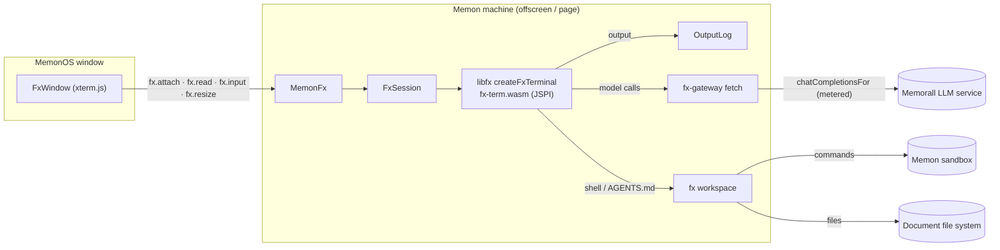

# fx in MemonOS

MemonOS runs [fx](https://github.com/vercel-labs/fx), Vercel Labs' coding
agent (Apache-2.0), as a built-in app: its own terminal, its own agent
harness and slash commands, on the user's Memorall model, the agent's skills
and the computer's sandbox. fx comes from
[libfx](https://www.npmjs.com/package/libfx) (`libfx@0.0.14`, pinned), which
ships the fx CLI's terminal compiled to WebAssembly (`fx-term.wasm`).

| fx needs | MemonOS gives it | Where |
|---|---|---|
| A screen and keyboard | An output log the fx window (xterm.js) replays and follows; keys sent back | `output-log.ts`, `FxWindow.tsx` |
| A model | Its AI Gateway calls answered by Memorall's chat model, metered | `fx-gateway.ts`, `language-model-bridge.ts` |
| A shell | Its `shell` tool run in the Memon sandbox (almostnode), on the agent's files | `fx-workspace.ts` |
| Skills | The agent's turned-on skills, listed in fx's home AGENTS.md, each in `~/.fx/skills/<name>/SKILL.md` | `fx-skills.ts` |
| Settings, history, sessions | Files under `~/.fx/terminal/` in the agent's home | `fx-stores.ts` |

Code lives in `src/services/memon/apps/fx/`; the machine owns one fx per
computer (`MemonFx`), like pi code.

## Lifecycle

- Opening the fx window asks for a folder, with pi code's folder picker
  (`CodeFolderPicker`): the folders fx was used in, the last first, each
  labelled with its last prompt and able to **Continue** its last
  conversation, then the folders to go through, a typed path or a new
  folder. The folder button over a running fx opens the picker again to move
  it. `fx [-c] [folder]` in the Terminal opens it in a folder directly.
- fx keeps its conversations per folder: the session store records each
  one's folder and lists only the current folder's, so `/resume` and
  `--resume last` (Continue, `fx -c`) stay in that folder.
- Closing the window, fx's `/exit`, turning fx off for the agent or shutting
  the computer down stops it. Leaving the view (another tab, the panel
  collapsed) does not: fx keeps working, and the next view replays its
  output from the start, since fx prints inline and cannot redraw.
- The agent settings' fx switch (`MemonFeatureConfig.fx`, on by default)
  takes it off the desktop. MemonOS Bot knows fx is there but does not drive
  it: fx is the user's terminal.

## The model gateway

fx sends model calls to Vercel AI Gateway as AI SDK language-model calls
(specification v4) and reads AI SDK stream parts back as server-sent events.
The terminal is given a `fetch` that answers them instead:

- `POST …/v4/ai/language-model`: the call becomes a Chat Completions request
  on the chat's current model (`language-model-bridge.ts`), sent through the
  metered models port, and the streamed chunks become stream parts: text,
  reasoning, tool calls, finish with usage. `ai-language-model-streaming:
  false` gets the whole reply as one generate result.
- `GET …/v1/models`: the chat model's provider's models, as
  `memorall/<model id>`, for fx's `/model` menu. A model fx picks is used
  when that provider lists it; otherwise the chat model answers.
- Anything else is refused: fx reaches nothing outside Memorall.

fx is given a placeholder AI Gateway key so it does not ask to sign in; no
provider key reaches it. Requests are booked on the Usage page under the
`fx` source, per fx session.

## Commands and permissions

fx's `shell` runs every command in the Memon sandbox with `HOME` set to the
agent's home, so `~` is the same for fx, the Terminal and pi code. The
workspace is `allow-sandboxed`: fx runs commands without asking and the
sandbox is the boundary, as it is for pi code. fx's own permission modes do
not work in its WebAssembly build (libfx 0.0.14): `auto` has no reviewer
model and holds every command, and `ask`'s approval prompt crashes the page
it runs in, which on the extension is the offscreen document that runs
Memorall's services. Revisit this when libfx fixes either.

## Skills and instructions

fx's own skill loader needs a file system the WebAssembly build lacks
("Skills are unavailable in this host"). So the home AGENTS.md fx reads
through the workspace is written by Memorall: what MemonOS is, the agent's
turned-on skills by name and description with the path of each SKILL.md,
then the user's own `~/.fx/AGENTS.md`. fx reads a skill with `cat` when a
task matches it. Skills are written when fx starts; a skill turned off is
removed then.

## Requirements

The WebAssembly terminal needs JSPI (`WebAssembly.Suspending`): current
Chrome and Edge, and Safari 27+. So the extension has it; the web app has it
in those browsers, and the desktop app when its system webview does
(WebView2 on Windows). Elsewhere the fx window says what is missing.
`tools/copy-bundled-assets.mjs` copies `fx-term.wasm` and its license to
`public/vendors/fx/`, since MV3 runs no remote WebAssembly.
